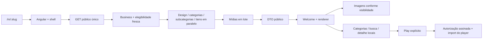

# Cardápio público — UI, UX e performance

Auditoria e implementação em 15/10/2026. Escopo: consumidor em `/m/:slug`, renderer compartilhado com o preview e infraestrutura necessária ao carregamento público. As alterações anteriores de Início e Analytics do painel foram preservadas.

**Classificação:** IMPLEMENTADO = código entregue; VALIDADO = comportamento verificado; MEDIDO = número coletado; RECOMENDADO = próxima etapa; NÃO EXECUTADO = sem evidência ou aplicação neste trabalho. Medições de laboratório não representam produção ou CrUX.

## Arquitetura e auditoria inicial

O Angular usa uma SPA com rotas lazy. `PublicMenuComponent` abre o cardápio; `PublicMenuViewComponent` renderiza Welcome, vitrine, categorias, subcategorias e detalhe. O mesmo renderer atende ao preview do proprietário. Os quatro templates existentes são `modern`, `minimal`, `premium` e `dark`, definidos em `design.service.ts`; fontes, sete tokens de cor, categorias e módulos continuam configuráveis.



A leitura do código encontrou **uma chamada de conteúdo do navegador** e **sete operações de banco** no caminho configurado com Supabase: business, RPC de elegibilidade, quatro consultas paralelas e mídia em lote. Não havia N+1 de produtos. O QR indireto `/q/:identifier` acrescenta a resolução do QR antes de `/m/:slug`. Contagens de banco são análise estática, sem medição de latência em um banco de cliente.

Antes, o loading público montava seis frames WebP do mascote mesmo quando oculto; o shell aguardava os dados; a entrada usava uma cortina temporizada; imagens de módulos eram eager e os slides inativos também baixavam; o HTML carregava o catálogo completo de fontes. Getters refaziam filtros, ordenações e objetos SVG confiáveis. A navegação ainda provocava leituras síncronas de layout em `AfterViewInit`, confirmadas pelo perfil de CPU. A publicação utiliza dados live, sem snapshot público imutável.

## Medições reproduzíveis

Build de produção anterior preservado antes das alterações. Fixture idêntica: 60 produtos, seis categorias, módulos habilitados, API local com 200 ms de espera, imagens WebP locais de 100.770 bytes sob URLs distintas. Três execuções por template/rede em 390×844 e uma nos outros quatro viewports, totalizando 26 execuções antes e 26 depois.

| Perfil | Latência | Download | CPU |
|---|---:|---:|---:|
| Wi-Fi | 0 ms adicional | 160 Mbps | 1× |
| Fast 4G | 150 ms | 9 Mbps | 4× mais lento |
| Slow 4G | 200 ms | 1,6 Mbps | 4× mais lento |

Web Vitals coletados pela biblioteca oficial, Chromium, cache desativado, HTTP local e gzip. O viewport de laboratório é estreito; o E2E adicional usa emulação Pixel 7. Isso não substitui um aparelho físico.

As fontes externas foram isoladas nas duas fases para reduzir variação de terceiros. Portanto, os números **não medem economia de transferência de fontes nem CLS após fontes reais**; a seleção de famílias foi validada separadamente. TTFB é do documento HTML local, não da API/Supabase. LCP corresponde ao Welcome antes da primeira interação. Tempos de entrada e detalhe incluem a automação, estabilidade do alvo e animações. Os estágios de categoria/produto incluem o clique controlado em “Ver o Cardápio”; não são uma navegação automática após o QR.

<!-- measured-results:start -->
**MEDIDO — medianas antes → depois em 390×844 (três execuções por rede/template).** Tempos em ms; CLS sem unidade.

| Template | Rede | TTFB | FCP | LCP | CLS | INP |
| --- | --- | --- | --- | --- | --- | --- |
| modern | wifi | 8 → 5,7 | 492 → 500 | 524 → 500 | 0,002 → 0,001 | 144 → 112 |
| modern | fast4g | 6,7 → 5,3 | 1.676 → 2.108 | 2.060 → 2.108 | 0,001 → 0,005 | 552 → 552 |
| modern | slow4g | 6,8 → 4,5 | 2.696 → 3.228 | 3.628 → 3.228 | 0,001 → 0,002 | 1.120 → 928 |
| minimal | wifi | 5,8 → 4,3 | 484 → 492 | 488 → 492 | 0,002 → 0,001 | 128 → 96 |
| minimal | fast4g | 5,7 → 5,2 | 1.596 → 2.152 | 2.004 → 2.152 | 0,001 → 0,002 | 560 → 640 |
| minimal | slow4g | 7,4 → 5,4 | 2.700 → 3.444 | 3.700 → 3.444 | 0,001 → 0,001 | 1.072 → 720 |

**MEDIDO — etapas em ms.** Shell/Welcome/categoria/produto são marcos de visibilidade do DOM desde a navegação; entrada e detalhe incluem a ação automatizada.

| Template | Rede | Shell | Welcome/hero | 1ª categoria | 1º produto | Entrada após clique | Abrir detalhe |
| --- | --- | --- | --- | --- | --- | --- | --- |
| modern | wifi | 470 → 186 | 470 → 446 | 1.920 → 884 | 1.982 → 884 | 1.184 → 149 | 580 → 77 |
| modern | fast4g | 1.879 → 1.405 | 1.880 → 2.012 | 3.787 → 3.281 | 3.877 → 3.281 | 1.822 → 905 | 993 → 592 |
| modern | slow4g | 3.458 → 2.141 | 3.458 → 3.008 | 5.570 → 4.601 | 5.570 → 4.601 | 1.810 → 1.371 | 727 → 410 |
| minimal | wifi | 433 → 185 | 433 → 447 | 1.925 → 889 | 1.838 → 889 | 1.185 → 138 | 517 → 82 |
| minimal | fast4g | 1.811 → 1.445 | 1.811 → 2.013 | 3.875 → 3.133 | 3.875 → 3.133 | 1.806 → 850 | 942 → 448 |
| minimal | slow4g | 3.506 → 2.426 | 3.507 → 3.284 | 5.633 → 4.374 | 5.634 → 4.374 | 1.854 → 1.075 | 810 → 317 |

**MEDIDO — arquivos e transferência.** Bootstrap é main + chunk inicial; jornada inclui todos os scripts observados até o detalhe, inclusive telemetria. Gzip calculado igualmente nos arquivos das duas fases, sem cabeçalhos HTTP.

| Recurso (bytes) | Antes | Depois |
| --- | --- | --- |
| JS de bootstrap bruto | 401.504 | 361.386 |
| JS de toda a jornada pública bruto | 650.235 | 625.480 |
| JS de toda a jornada pública gzip | 179.202 | 176.475 |
| CSS global bruto | 58.381 | 43.657 |

O total da jornada inclui os novos skeletons, defer e observabilidade. A economia de carregamento também vem da remoção dos seis frames e dos assets antecipados; o runtime de formulários deixou a rota pública após simplificar o único input de busca.

**MEDIDO — coorte inicial Wi-Fi, com a limitação descrita na metodologia.** Não representa o total de toda a página nem uma comparação de transferências pendentes em 4G. O payload do fixture é intencionalmente igual.

| Template | Respostas na coorte | Bytes concluídos da coorte | JSON do fixture (bytes) |
| --- | --- | --- | --- |
| modern | 15 → 12 | 896.314 → 413.246 | 22.490 → 22.490 |
| minimal | 15 → 12 | 896.325 → 413.257 | 22.501 → 22.501 |

**MEDIDO — Lighthouse 13.5.0, uma execução por template/fase, Welcome em 390×844, 200 ms / 1,6 Mbps / CPU 4×.**

| Template | Performance | Accessibility | Best Practices | LCP (ms) | CLS |
| --- | --- | --- | --- | --- | --- |
| modern | 63 → 74 | 100 → 100 | 100 → 100 | 5.141 → 4.248 | 0,007 → 0,008 |
| minimal | 60 → 72 | 100 → 100 | 100 → 100 | 5.628 → 4.534 | 0,007 → 0,009 |

Os resultados são mistos. FCP anterior podia corresponder ao texto do loader; o skeleton atual é geométrico e o conteúdo textual vem no Welcome. O DOM do shell não é uma medição de pixels nem de interatividade. Consultar todas as linhas antes de declarar melhora de LCP ou INP. LCP em Slow 4G e INP com CPU reduzida ainda podem ultrapassar as metas; três amostras locais não formam um p75 de campo.

**MEDIDO — variação do INP após a mudança, mínimo–máximo das três amostras em 390 px:** modern/wifi: 96–112 ms; modern/fast4g: 464–672 ms; modern/slow4g: 920–928 ms; minimal/wifi: 88–112 ms; minimal/fast4g: 528–704 ms; minimal/slow4g: 656–984 ms.
<!-- measured-results:end -->

Os arquivos completos de laboratório e as capturas estão em `.tools/public-menu-performance/`. A evidência versionada contém as execuções individuais e as medianas em [public-menu-performance-evidence.json](public-menu-performance-evidence.json). O comparativo usa o mesmo fixture; ele não demonstra redução do payload de todos os estabelecimentos.

**Regressão observada:** no Minimal/Fast 4G, INP passou de 560 para 640 ms (+14,3%). Nesse perfil, LCP também subiu de 2.004 para 2.152 ms; no Modern/Fast 4G, de 2.060 para 2.108 ms. A entrada e o detalhe ficaram mais rápidos, mas não houve ganho uniforme nas métricas. Essa regressão permanece registrada para acompanhamento; a amostra de três execuções não permite atribuir significância estatística nem prometer a meta em produção.

## Entrega em 22 pontos

| # | Item solicitado | Classificação e resultado |
|---|---|---|
| 1 | Arquitetura encontrada | **VALIDADO:** rota, quatro templates, Welcome, vitrine, catálogo, detalhe, likes, Mux, fontes, design e analytics mapeados. Publicação live e boundary de elegibilidade identificados. |
| 2 | Fluxo de carregamento | **IMPLEMENTADO / VALIDADO:** shell e skeleton locais; renderer adiantado em paralelo com a API; conteúdo após elegibilidade; entrada sem cortina bloqueante. |
| 3 | Gargalos | **VALIDADO / MEDIDO:** downloads dos seis frames, fontes globais, imagens eager, espera artificial, cálculos repetidos e layout síncrono. Perfil de CPU auxiliar disponível nos artefatos locais. |
| 4 | Mudanças | **IMPLEMENTADO:** OnPush, computeds de catálogo/busca/grupos/destaques, cache de SVG local, renderer defer, módulos por viewport, imagens seguras, foco e feedback de erro. Busca usa input nativo com composição preservada, sem baixar Angular Forms. Eventos de imagem e observação de visibilidade não iniciam detecção global de mudanças. |
| 5 | Arquivos | **IMPLEMENTADO:** inventário abaixo. Mudanças globais restritas ao bootstrap de fontes, import lazy do login e integração necessária; editor e regras comerciais preservados. |
| 6 | Requests | **MEDIDO / VALIDADO:** conteúdo 1→1; categoria, pesquisa e detalhe continuam sem novos GETs; zero autorização/player/stream antes de Play. QR indireto exige uma resolução adicional. Telemetria ocorre fora do caminho crítico. |
| 7 | Payload | **IMPLEMENTADO / MEDIDO PARCIAL:** whitelist remove customizações administrativas e repetição de banners/configurações de hero do `customConfig`; DTO mantém campos públicos usados. Fixture de controle e coorte Wi-Fi no comparativo. **NÃO EXECUTADO:** comparação de payloads reais de clientes. Base64 legado permanece compatível. |
| 8 | LCP | **MEDIDO:** medianas acima, mesmos templates e redes. Meta <2,5 s não deve ser presumida nos cenários que a ultrapassam. |
| 9 | CLS | **MEDIDO:** valores acima para o fluxo controlado. Dimensões reservadas e placeholders impedem reflow por chegada da imagem. Fontes reais e toda combinação de configuração não foram certificadas. |
| 10 | INP | **MEDIDO:** biblioteca oficial e três interações controladas por visita. Meta <200 ms permanece objetivo onde o perfil com CPU reduzida a exceder; não foi substituída por TBT. |
| 11 | Bundle | **MEDIDO:** bootstrap e jornada pública discriminados no comparativo. Nenhum chunk JS das telas de Dashboard, Design Editor, PDF, Analytics interno ou player Mux entra na jornada anterior ao Play. Pequenos guards/serviços compartilhados ainda pertencem ao bootstrap. O CSS global ainda reúne estilos da plataforma. |
| 12 | Imagens | **IMPLEMENTADO / VALIDADO:** largura/altura ou proporção reservadas, lazy de cards, decode async, fade de 180 ms, fallback SVG local, URLs raster validadas e variantes em CDNs compatíveis. Storage original/Base64 não ganha variantes fictícias. |
| 13 | Skeletons | **IMPLEMENTADO / VALIDADO:** Welcome com perfis de template e hint apenas visual; atraso de 120 ms e mínimo visual de 120 ms. Módulos secundários reservam grid/carrossel e superfície reais. Detalhe abre com texto local e galeria 16:10 reservada. O primeiro acesso usa superfície neutra até conhecer o design. |
| 14 | Lazy loading | **IMPLEMENTADO / VALIDADO:** rota, renderer, módulos de chef/combos/mais vendidos por viewport; imagens dos cards lazy; somente slide ativo ganha imagem; famílias selecionadas e Web Vitals carregados à parte. |
| 15 | Vídeo | **IMPLEMENTADO / VALIDADO:** poster primeiro, import e autorização em paralelo somente após Play, `preload="none"`, sessão assinada, proteção contra resposta tardia após fechar e restauração de foco. E2E de formatos horizontal/vertical e Escape. Reprodução real ponta a ponta com provedor não foi executada. |
| 16 | Optimistic UI | **VALIDADO / IMPLEMENTADO:** comportamento existente mantido, coração e contador imediatos, reconciliação e rollback com mensagem discreta. Unicidade e antiabuso do backend preservados. |
| 17 | Testes | **VALIDADO:** 33 testes frontend; 63 backend (60 da bateria pública/segurança e três da migração de likes); 26 E2E públicos em desktop/celular; revalidação adicional de 14 E2E após a simplificação da busca. Builds e scanner de segredos registrados abaixo. |
| 18 | Rede lenta | **MEDIDO:** Fast/Slow 4G, latências de 150/200 ms e CPU 4×. **VALIDADO:** busca/categoria continuam locais com navegador offline após receber os dados. Abertura inicial offline não é suportada nem foi anunciada como tal. |
| 19 | Lighthouse | **MEDIDO:** antes/depois acima, auditoria do Welcome em dois templates. Acessibilidade e Best Practices nesse escopo não certificam toda a aplicação nem todas as paletas do cliente. |
| 20 | Segurança | **VALIDADO:** elegibilidade fresca, isolamento por business, mídia assinada, limites, unicidade, CSP e sanitização mantidos; `no-store` também nas negativas; telemetria restrita, JSON de 2 KB e 30 envios/minuto. Nenhuma alteração de RLS ou segredo no cliente. |
| 21 | Riscos residuais | **RECOMENDADO / NÃO EXECUTADO:** validar dispositivos físicos, Safari, produção, fontes reais, fotos reais e grandes catálogos. Permanecem a regressão medida no INP do Minimal/Fast 4G, Base64 legado, alguns assets locais maiores que seu uso visual, CSS compartilhado de templates/plataforma e armazenamento agregado apenas em logs. |
| 22 | Próxima etapa | **RECOMENDADO:** pipeline de imagens, snapshot não destrutivo com gate fresco, shell pré-renderizado, separação de CSS, acompanhamento de percentis em produção e limites de contraste no editor. Planos descritos abaixo; sem migração ou deploy nesta tarefa. |

## Imagens, skeletons e preservação da marca

`MenuImageDirective` centraliza dimensões, prioridade, fallback e candidatos responsivos. Somente URLs conhecidas do Unsplash ou URLs **já optadas** no endpoint público de transformação do Supabase recebem `srcset`/resize. URLs arbitrárias e objetos originais não recebem parâmetros que o servidor talvez não suporte. Transformações de imagem do Supabase dependem de disponibilidade no plano, conforme a [documentação oficial](https://supabase.com/docs/guides/storage/serving/image-transformations).

O pipeline não reescreve URLs privadas assinadas para torná-las públicas. O backend rejeita fontes ativas, data SVG, credenciais embutidas e referências privadas assinadas de Storage no DTO. Raster Base64 existente continua suportado para preservar cardápios atuais; a transferência dessas imagens dentro do JSON continua sendo um gargalo.

Welcome preserva sua marca e fundo escolhido; o público sem capa configurada usa a identidade textual do estabelecimento, sem inserir fotografia genérica de outro prato. Hero, logos e cards mantêm suas proporções; módulos desabilitados/vazios não criam buracos ou assets adicionais. O primeiro hero visual importante usa prioridade alta; não há dezenas de imagens com essa prioridade. Os cards de catálogo ganharam espaço para descrição, preço e ações de toque sem sobreposição.

O skeleton inicial conhece o template quando existe hint visual na sessão. Esse hint contém apenas template e cores validadas, nunca identidade, produtos ou autorização. O primeiro acesso não consegue conhecer um design personalizado antes da única resposta pública: essa limitação depende de renderização no servidor para ser eliminada. Placeholders dos módulos reutilizam classes de grid/carrossel e superfície do renderer; os módulos recebem dados já disponíveis quando entram no viewport. Movimento reduzido desativa shimmer/pulso, fades e entrada animada.

As categorias, subcategorias e pesquisa são locais, com normalização de acentos. O detalhe não espera um endpoint adicional. Modal tem nome acessível, foco inicial, Escape e retorno de foco; fundo fica inerte enquanto o detalhe/vídeo está aberto. Os cards da vitrine têm acionamento por teclado, a pesquisa tem rótulo, categorias indicam página atual e o erro de curtida usa status discreto. Paletas arbitrárias continuam dependentes das cores escolhidas pelo proprietário.

## Observabilidade e privacidade

`web-vitals` oficial registra LCP/CLS/INP/FCP/TTFB disponíveis. Não inventa zero quando não existe amostra. O envio único usa `keepalive`, sem cookies, respeita DNT/GPC e não bloqueia a navegação. Em navegação SPA, as métricas do documento pertencem ao primeiro menu elegível; não são anunciadas como métricas independentes de cada troca de slug. A definição segue a [biblioteca oficial](https://github.com/GoogleChrome/web-vitals).

O endpoint valida nomes/valores limitados, quatro templates e três classes genéricas de dispositivo; verifica elegibilidade novamente e emite somente contagem, soma e faixas por métrica. Não inclui slug, business, identificador de visitante, URL, seletor, IP, referrer ou token no registro agregado. O transporte HTTP necessariamente alcança o servidor; não há promessa de ocultar IP da infraestrutura de rede. Logs gerais já existentes devem manter sua política de retenção.

Marcas locais `pc:menu:request-start`, `pc:menu:response`, `pc:menu:data-ready` distinguem API e preparação visual. A telemetria existente do BFF pode registrar duração e operações de banco por rota anonimizada quando habilitada. **NÃO EXECUTADO:** dashboard de Web Vitals, rollup durável no banco e p75 de tráfego real; logs de soma/faixas não permitem declarar um p75 exato. Métricas anônimas enviadas pelo cliente são sinal operacional não confiável, sem papel em autorização ou cobrança.

Documentos iniciados em uma página não pública, como o painel, não passam a emitir suas métricas anteriores quando uma navegação interna abre um menu. Isso evita atribuição incorreta ao template.

## Snapshot seguro — plano sem migração destrutiva

1. Adicionar publicações versionadas com `business_id`, versão de schema, checksum, DTO público e manifesto de assets; armazenar snapshots internamente, sem endpoint público que contorne a elegibilidade.
2. Gerar snapshot no backend durante publicação autorizada e trocar o ponteiro atual de forma atômica. Manter leitura live compatível para estabelecimentos ainda não migrados e versões anteriores para rollback.
3. Em **todo GET público**, validar conta, business, publicação e elegibilidade comercial frescos. Só depois consultar o snapshot/cache interno por versão. Indisponibilidade do gate deve falhar fechado, sem stale-if-error.
4. Manter o alias público `no-store`. Cache de conteúdo imutável pode ser interno/edge atrás do mesmo gate, sem tornar um JSON antigo acessível diretamente após suspensão. Invalidação/purge isolado não substitui esse gate.
5. Testar suspensão, despublicação, troca de plano, rollback, concorrência de publicação e isolamento entre tenants antes do rollout gradual. Likes e tokens de vídeo mantêm seus próprios gates e limites.

Contagens de curtidas permanecem em uma camada mutável com atualização/overlay em lote; não ficam congeladas até a próxima publicação. O snapshot não contém tokens de playback nem URLs privadas assinadas.

## Pipeline de imagens — próxima etapa

Inventariar em staging as dimensões, bytes e formatos reais por finalidade, sem registrar URLs privadas. O caminho atual inclui uploads raster Base64 no registro e um piloto de Storage privado ainda não ativado para todo o público. Implantar escrita dupla autorizada: original privado, validação/remoção de metadados e derivados thumbnail/medium/large WebP/AVIF, com referências públicas estritamente publicáveis no manifesto. Definir dimensões a partir dos cards existentes, detalhe e hero; usar candidatos por DPR, não um único original grande.

Backfill deve ser idempotente, por business e com checksum; manter o campo legado até verificar leitura/publicação, não apagar originais nesta fase. Avaliar custo/limites de transformação do plano antes de ativar o endpoint Supabase. Só depois retirar Base64 do DTO público. Nenhuma tabela, bucket, política ou dado de cliente foi modificado nesta entrega.

## Budgets e limites de validação

- **VALIDADO:** GET de conteúdo = 1; GET adicional por categoria/busca/detalhe = 0; player/stream antes de Play = 0; famílias públicas limitadas à seleção de título/corpo, sem catálogo global.
- **MEDIDO / VALIDADO:** o script de consolidação verifica bootstrap ≤401.504 bytes brutos e JS público completo gzip ≤179.202 bytes, limites derivados do baseline. Também verifica um GET de conteúdo e ausência de downloads dos frames do loading em todas as execuções finais. Os quatro budgets passaram; os valores estão no JSON de evidências.
- **RECOMENDADO:** usar LCP <2,5 s, CLS <0,1 e INP <200 ms como metas de campo, acompanhadas por template/dispositivo; não transformar uma única execução local em SLA.
- **NÃO EXECUTADO:** budget universal de KB de foto por card antes do inventário real e rollout de variantes. O fixture de laboratório não representa a distribuição de imagens dos clientes.
- O build ainda avisa sobre CSS do renderer público acima do warning de 25 KB e abaixo do limite de erro de 40 KB. O warning existente do Design Editor também permanece. O limite não foi aumentado para ocultar avisos.

## Arquivos desta fase

- Público e imagens: `frontend/src/app/pages/public-menu/public-menu.component.ts`, `components/public-menu-view/public-menu-view.component.ts`, `menu-reveal.directive.ts`, novos `menu-image.directive.ts` e `public-menu-skeleton.component.ts`, `frontend/public/assets/menu/image-placeholder.svg`.
- Interações: `components/product-media-gallery/product-media-gallery.component.ts`, `components/dialog-focus.directive.ts`, `services/public-menu.service.ts`.
- Bootstrap/fontes/telemetria: `app.ts`, `app.routes.ts`, `app.spec.ts`, `services/menu-fonts.service.ts`, `services/public-vitals.service.ts`, `frontend/src/index.html`, `styles.css`, `package.json` e lockfile. Caminhos de componentes/serviços relativos a `frontend/src/app/`.
- Backend: `backend/src/controllers/public.controller.ts`, novos `public-vitals.controller.ts` e `services/public-menu-presentation.ts`, `routes/public.routes.ts`, `server.ts`.
- Testes novos: specs de imagens, renderer, fontes e vitals; `frontend/e2e/public-menu-performance.spec.ts`; `backend/src/__tests__/public-menu-performance.test.ts` e `public-vitals-routes.test.ts`.
- Testes públicos atualizados: `pingo-loader.spec.ts`, `public-subcategories.spec.ts`, `public-menu-clean-cards.spec.ts`, `public-video-playback.spec.ts`. Fixtures isolam fontes externas; teste de entrada passa a exigir ausência de cortina/frames do loader público.
- Ferramentas/evidências: `frontend/scripts/audit-public-menu.mjs`, `summarize-public-menu-audit.mjs`, este relatório e JSON associado. Lighthouse instalado somente em `.tools`, fora das dependências do produto.

## Verificação e reprodução

```powershell
# Frontend (cwd: frontend)
npm run build -- --stats-json
npm run security:scan
npm test -- --watch=false --include='src/app/components/public-menu-view/*.spec.ts' --include='src/app/services/menu-fonts.service.spec.ts' --include='src/app/services/public-vitals.service.spec.ts' --include='src/app/services/public-menu.service.spec.ts' --include='src/app/components/product-media-gallery/*.spec.ts' --include='src/app/services/public-analytics.service.spec.ts' --include='src/app/app.spec.ts'
npx playwright test public-menu-performance.spec.ts public-menu-clean-cards.spec.ts public-subcategories.spec.ts public-video-playback.spec.ts pingo-loader.spec.ts --grep-invert='uses dark'
node scripts/audit-public-menu.mjs --phase after --repeats 3
node scripts/audit-public-menu.mjs --phase after --lighthouse
node scripts/summarize-public-menu-audit.mjs

# Backend (cwd: backend)
npm run build
npm test -- --runInBand public-vitals-routes public-menu-performance public-menu-subcategories video-routes-security product-playback security performance-security design-settings anonymous-like-migration
```

O harness de Lighthouse usa a instalação temporária de `lighthouse@13.5.0` em `.tools/public-audit-tools` e Chromium do Playwright. Para recriar o ambiente, executar em `frontend`: `npm install --prefix '../.tools/public-audit-tools' --no-save lighthouse@13.5.0`. Baseline usa `--phase before --dir ../.tools/public-menu-baseline/site`; o build anterior precisa estar preservado antes da alteração.

**Fora do escopo público:** o teste antigo `uses dark as the dashboard default...` falhou porque usa autenticação legada em localStorage e não chega ao dashboard com o guard atual de sessão. Foi explicitamente excluído da bateria pública, sem modificar o fluxo de autenticação para fazê-lo passar. Uma execução pública intermediária também sofreu reload do servidor durante formatação; a bateria estável posterior passou integralmente.

**NÃO EXECUTADO:** deploy, alteração de dados/banco, migração de Storage, pagamento/planos, RUM real e reprodução real do Mux. O trabalho foi validado localmente com fixtures e mocks nos pontos de integração externa.
